# CircuitPython and STEMMA QT
Overblik over boards og komponenter, som er understøttet af CircuitPython. Både de nemme med STEMMA QT-forbindelse og nogle vigtige og fede, som er lidt mere komplicerede!
# [Boards](boards)

Læs om vores udvalg af forskellige boards der understøtter CircuitPython og STEMMA QT-forbindelsen.

<a href="boards">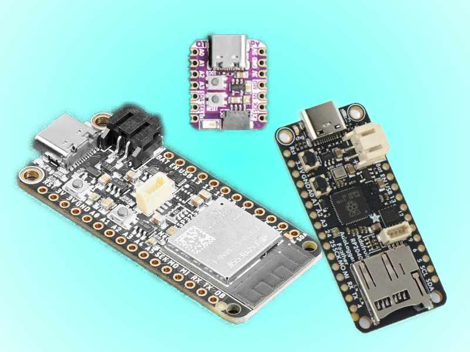</a>
<a href="boards">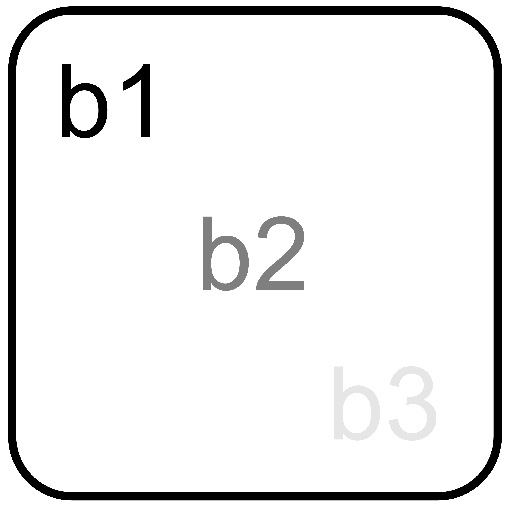</a>

# [STEMMA QT-komponenter](stemmaqt)
Komponenter der er stort set plug-n-play. Kan også kædes sammen. Ét kabel er alt du skal bruge!

<a href="stemmaqt">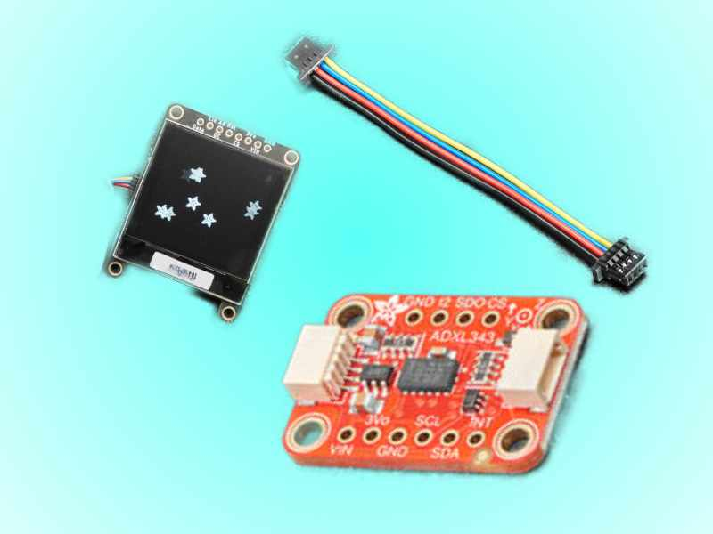</a>
<a href="stemmaqt">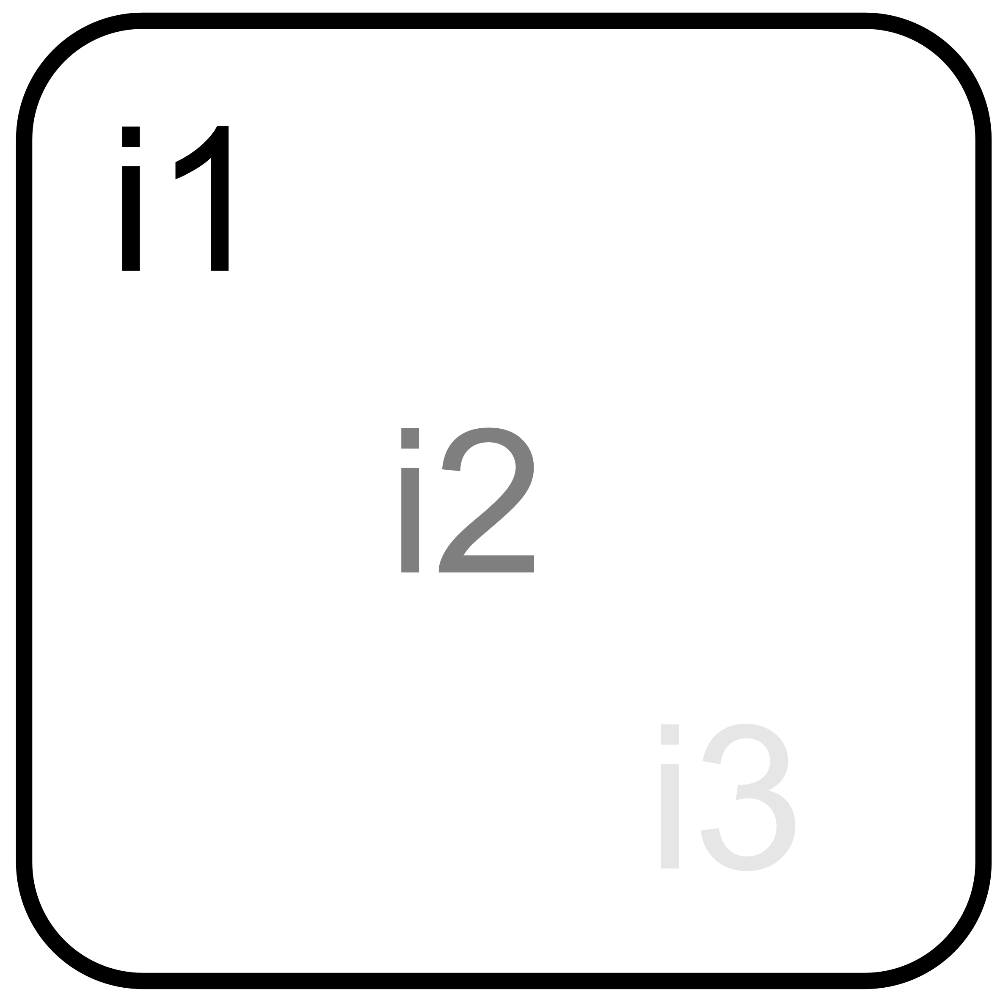</a>
<a href="stemmaqt">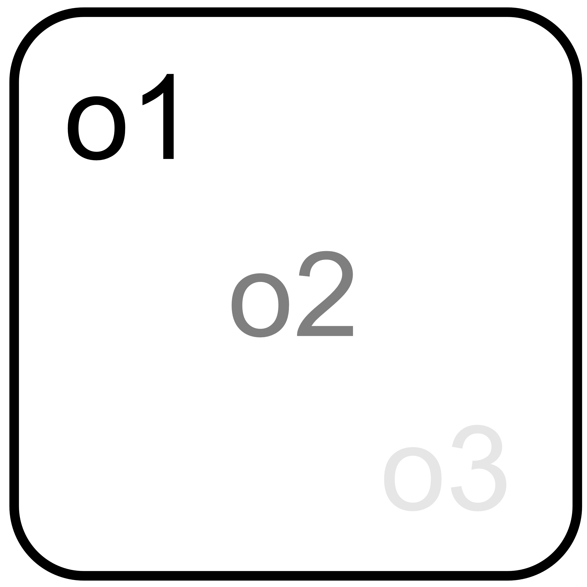</a>

# [Andre komponenter](other)
Andre komponenter der bruger 2,3,5,10 eller flere ledninger. De fleste er stadig nemme at bruge, og der er mange gode guides at finde herinde, så lad dig ikke skræmme. Der er virkelig nogle fede ting herinde, der kan være prikken over i'et på dit projekt.

<a href="other">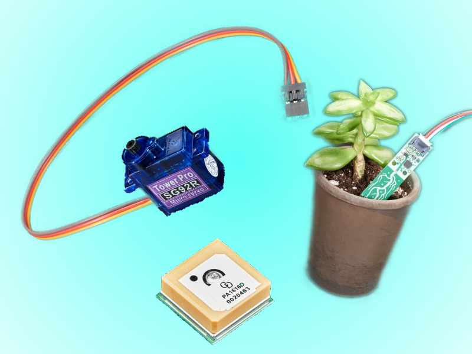</a>
<a href="other">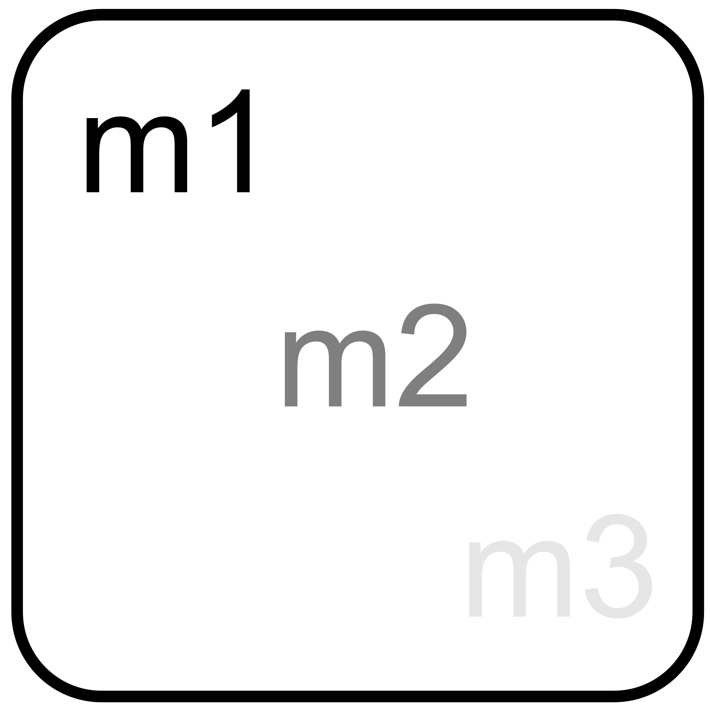</a>

# [Avancerede teknologier](advanced)
Wifi, bluetooth, API mm. Virkelig fede, men kræver mere opsætning og tid.

<a href="advanced">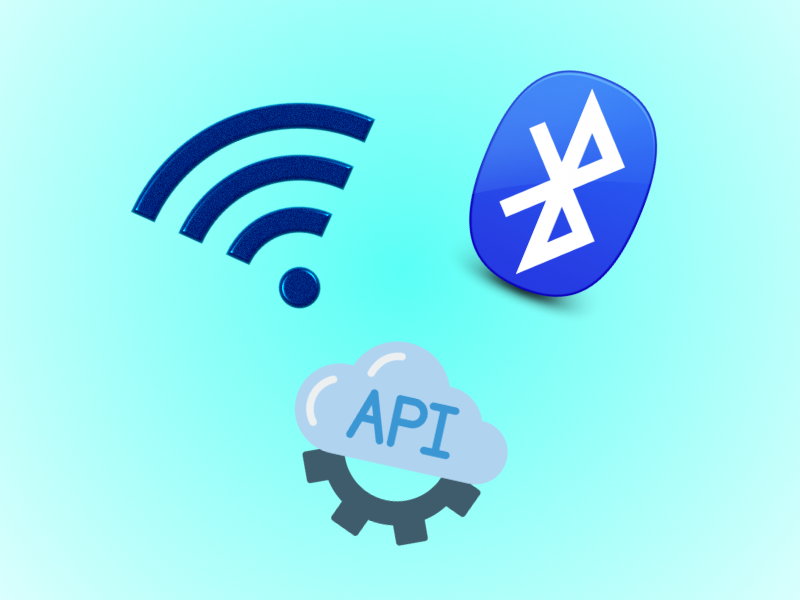</a>
<a href="advanced">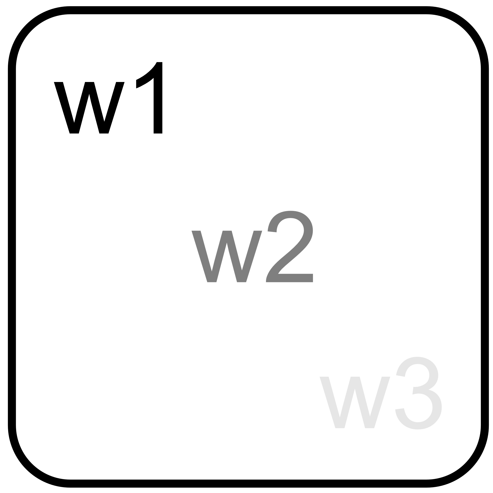</a>

# [Komplet guide til motorer](komplet_motor_guide)
Hvad kan de forskellige motorer? Hvordan tilslutter man dem? Skal de have 3V, 5V, 12V? Find alle svarene herinde!

<a href="komplet_motor_guide">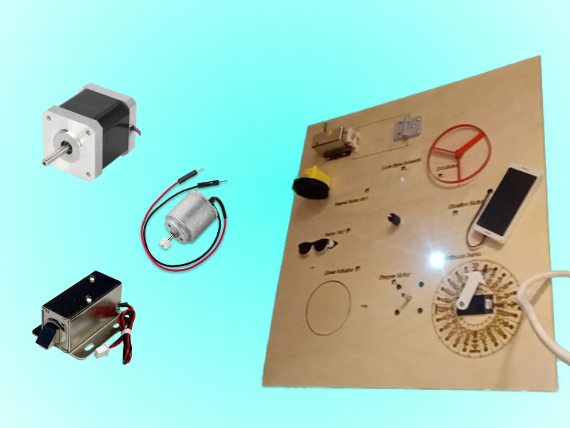</a>
<a href="komplet_motor_guide">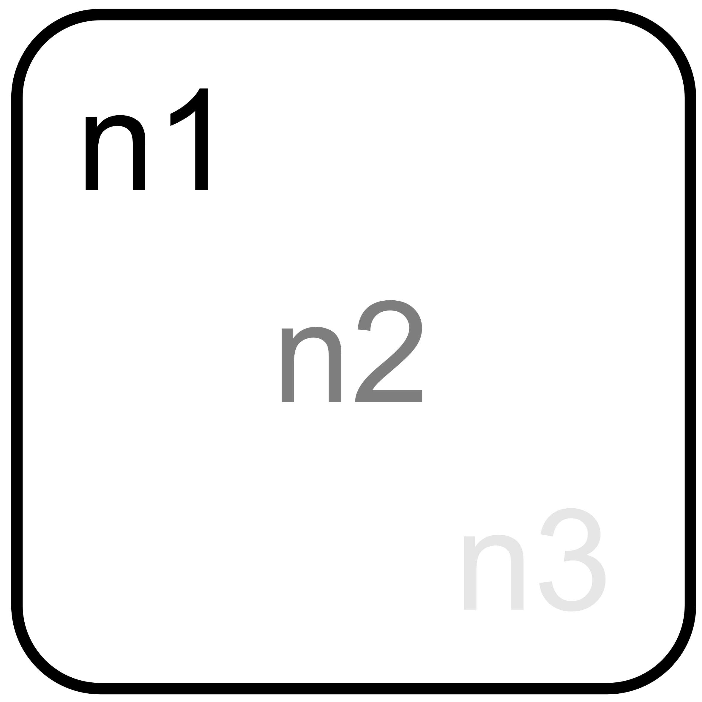</a>
